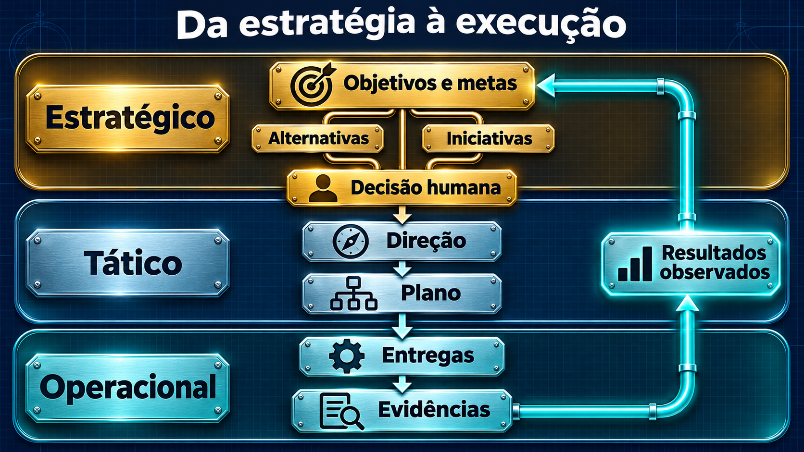
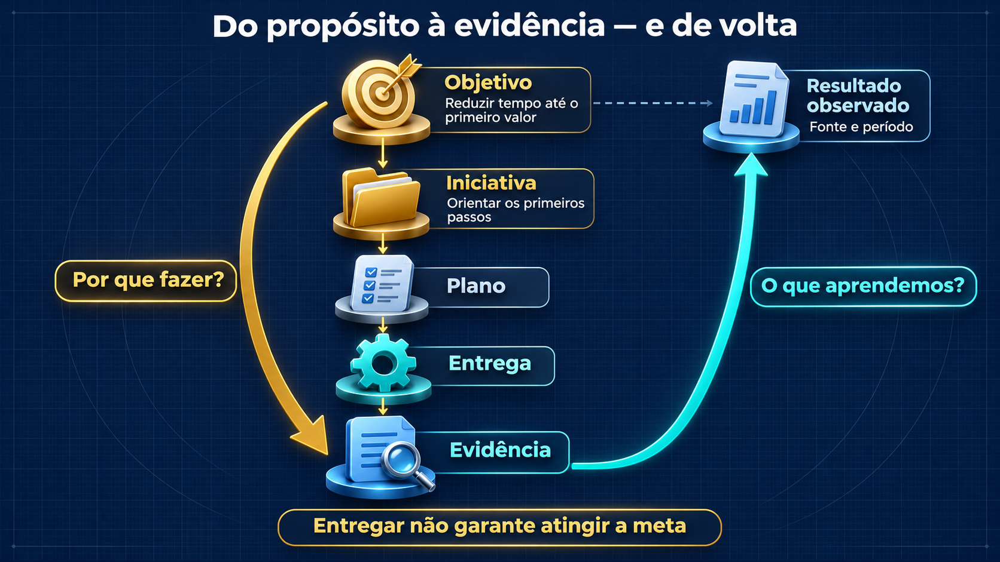
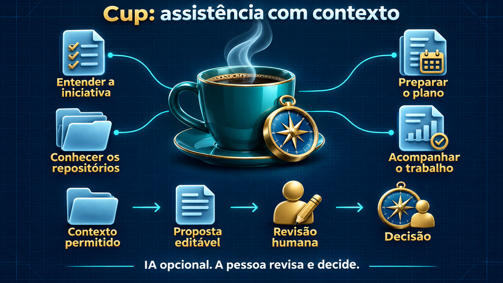

# Guilda

### Contexto, decisões e evidências conectados ao trabalho

**Pessoas decidem. O sistema apoia.**

A Guilda é um produto em desenvolvimento para conectar **objetivos de negócio, conhecimento dos repositórios, decisões humanas e entregas**. Sua proposta é ajudar produto, lideranças e engenharia a entender o que vale fazer, coordenar quem precisa participar e conferir o que mudou depois da execução.

[Conheça o site e as telas do produto](https://guilda.pages.dev)

*As ilustrações conceituais foram criadas com assistência de IA e representam a visão do produto. A seção sobre o estágio atual distingue as capacidades existentes das jornadas em construção.*

## O contexto precisa sobreviver à execução

Uma iniciativa nasce numa conversa, passa por documentos e tarefas e chega ao código. Na retomada, pode ser difícil encontrar o motivo da escolha, uma dependência de outro time ou a evidência do resultado. Acelerar a implementação com IA torna essas perguntas ainda mais relevantes:

- **O que já existe?** Que capacidades podemos reutilizar e quem responde por elas?
- **O que falta saber?** Quais dependências, riscos e dúvidas precisam ser examinados?
- **Por que esse caminho?** Quem escolheu a alternativa, com quais referências e limites?
- **O que mudou?** A entrega funciona? O efeito esperado no negócio foi observado?

A Guilda organiza as relações entre essas respostas para que a direção acompanhe o trabalho e as evidências possam informar a próxima decisão.

## Da estratégia à execução — e de volta à decisão

A visão do produto conecta três níveis:

| Nível | O que ajuda a compreender |
| --- | --- |
| **Estratégico** | Que problema merece atenção, qual efeito se espera e que alternativas considerar. |
| **Tático** | Como transformar a escolha num plano, com responsáveis, dependências e condições para avançar. |
| **Operacional** | O que precisa ser entregue, quais provas sustentam a entrega e o que os resultados permitem aprender. |

Essa organização se aplica tanto a uma pessoa conduzindo seu projeto quanto a times trabalhando em vários repositórios. A profundidade dos registros acompanha o contexto; os níveis não exigem departamentos separados.

**Um exemplo:** um time quer reduzir o tempo até uma pessoa perceber valor no produto. Antes de decidir construir um novo fluxo, examina o que já existe, identifica dependências e compara caminhos. A escolha orienta as entregas de experiência, implementação e instrumentação. Depois, o time confere o funcionamento e observa a métrica no período definido para decidir se mantém ou revê a aposta.

**Concluir as entregas não significa atingir a meta.** O resultado precisa de observação, fonte e interpretação; sua relação com a iniciativa não comprova causalidade por si só.

## Cup: assistência com contexto, revisão humana

O **Cup** é o assistente contextual da Guilda. Ele ajuda a entender campos, organizar perguntas, consultar informações permitidas e preparar propostas editáveis.

Na descoberta de um repositório, por exemplo, a assistência pode propor uma descrição e possíveis capacidades a partir das fontes selecionadas. A pessoa precisa poder conferir o contexto que será enviado, revisar as referências e corrigir a proposta. **Uma descrição inferida de arquivos não comprova que a capacidade funciona.**

O fluxo manual permanece disponível. Usar IA é opcional, com conexões locais ou remotas configuradas pela pessoa. Publicar informações, autorizar uma direção e aprovar uma entrega são atos distintos, exercidos por quem tem os poderes correspondentes.

## Registros sob controle de quem trabalha

A Guilda prioriza a operação no computador, com registros em arquivos versionados por Git. Quadros e mapas apresentam informações derivadas das fontes responsáveis. Caminhos locais, preferências e credenciais ficam separados dos registros compartilhados.

A arquitetura separa regras comuns, capacidades reutilizáveis e interfaces. O aplicativo desktop e a ferramenta de terminal consomem as mesmas capacidades públicas; o aplicativo tem composição nativa própria. Essa separação também mantém as integrações desacopladas da regra de negócio.

## O que existe hoje e o que está em construção

A base já reúne cadastro e reabertura de iniciativas, consulta e publicação de informações dos repositórios e preparação de direção e plano com assistência revisável. Há demonstrações em cenários controlados e desenvolvimento para **Windows e Linux**.

A evolução amplia essa base em cinco jornadas: compreender os repositórios e suas relações; explicitar propósito e medição; comparar alternativas; planejar entre responsáveis; observar resultados e rever a direção. **Essas jornadas ainda não constituem um ciclo integral entregue.** Comparação de prioridades e acompanhamento completo dos resultados permanecem em construção.

Este repositório apresenta o produto. O código do aplicativo e do motor permanece privado, e ainda não há instaladores publicados para uso geral.

## Documentação pública e distribuição

O `guilda-docs` é a porta de entrada pública da Guilda. Além desta apresentação, você pode explorar:

- [Como a Guilda é construída](docs/arquitetura.md): responsabilidades, tecnologias, limites e custos das escolhas de arquitetura.
- [Exemplo de primeiro valor](examples/primeiro-valor.md): um cenário fictício que conecta contexto, decisão, plano, evidências e medição.

Schemas e exemplos de registros YAML/JSON ainda não foram publicados aqui.

A proposta de distribuição prevê uso pessoal gratuito e modalidades comerciais para organizações. As condições de uso, o escopo dos formatos públicos e eventual acesso empresarial ao código precisam ser formalizados em licenças próprias. Esta apresentação não substitui esses termos nem anuncia modalidades já disponíveis para contratação.

## Autoria e contato

Criada por **Rosana Rezende**, reunindo experiência em engenharia de software, produto, experimentação e negócios. A direção de produto, as decisões arquiteturais e a avaliação das entregas são humanas, com assistência de IA na construção.

A investigação começou no [ai-guidelines](https://github.com/rosanarezende/ai-guidelines), contribuição anterior em código aberto. O foco atual de desenvolvimento é a Guilda.

[Site e apresentação](https://guilda.pages.dev) · [Perfil no GitHub](https://github.com/rosanarezende) · [LinkedIn](https://www.linkedin.com/in/rosanarezende/) · [Portfólio](https://rosanarezende.com)
