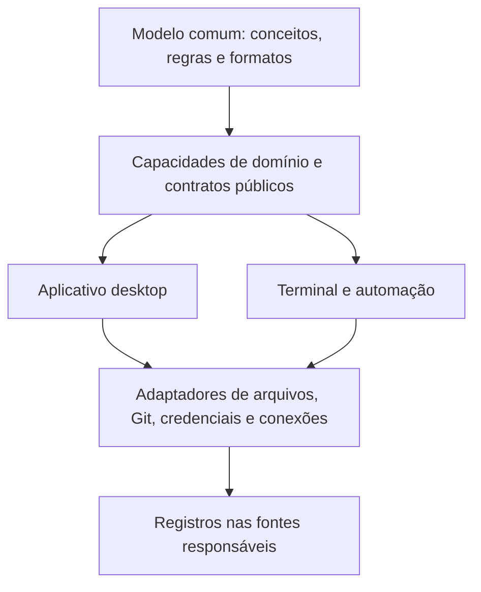

# Como a Guilda é construída

A Guilda precisa conservar o significado de uma decisão quando ela passa por uma interface, uma operação de arquivos ou uma automação. Sua arquitetura separa **quem define a regra, quem oferece a capacidade e quem apresenta a operação**.

Este documento explica o desenho técnico e seus custos. O [README](../README.md#o-que-existe-hoje-e-o-que-está-em-construção) concentra a apresentação do estágio atual; a existência de uma camada não significa que todas as jornadas estejam entregues.

## Responsabilidades e dependências

As setas mostram relações de construção e uso, não uma sequência de serviços remotos. O domínio declara as interfaces de que precisa; os adaptadores realizam os efeitos no ambiente. A composição de cada consumidor conecta essas peças.

| Responsabilidade | Nome técnico | Limite |
| --- | --- | --- |
| Definir conceitos, regras e formas válidas | Kernel | Não consulta o computador nem executa publicação. |
| Implementar capacidades reutilizáveis e declarar suas portas | Framework | Não depende da tela nem escolhe um mecanismo de armazenamento como regra de negócio. |
| Compor operações para terminal e automação | Flow | Consome as capacidades comuns e mantém apresentação própria. |
| Oferecer a experiência visual e a integração nativa | Desktop | Mantém formulários e interação; não cria uma regra de autoridade paralela. |

O aplicativo e o terminal são consumidores irmãos. O desktop tem composição própria, sem precisar executar a ferramenta de terminal como backend. Essa escolha permite uma experiência visual específica e conserva o compartilhamento das regras.

## Uma publicação atravessa mais que um formulário

Considere a revisão de uma descrição de repositório. A tela reúne o texto e as referências, mas o ato oficial precisa considerar identidade, poderes, revisão dos dados e persistência.

1. **Preparar:** a pessoa edita um rascunho, manualmente ou com assistência.
2. **Conferir:** a capacidade verifica as condições do domínio, as referências e a base sobre a qual a operação foi preparada.
3. **Autorizar:** a resolução de autoridade considera a pessoa, a ação, o objeto e o contexto. Identidade e assinatura, isoladamente, não concedem poderes.
4. **Publicar:** os adaptadores executam a operação pelos contratos correspondentes e conservam os registros da publicação.
5. **Recuperar quando necessário:** uma interrupção exige conferir a continuidade da operação antes de retomá-la. A recuperação não dispensa as condições aplicáveis.

Essas responsabilidades são separadas para evitar que um botão, um login ou uma resposta de IA se torne autorização implícita. A confirmação humana também não substitui a verificação da base e dos poderes.

## Registros oficiais, consultas e dispositivo

Os registros são mantidos em arquivos nas fontes responsáveis. O conjunto pode relacionar vários repositórios e componentes; a localização física de uma pasta não determina, sozinha, quem possui a informação ou pode alterá-la.

Quadros, mapas e prévias são **leituras derivadas** desses registros. Eles facilitam a navegação, mas não mantêm um andamento oficial concorrente. Uma prévia antiga pode ajudar na consulta; um ato de escrita exige conferir a base pertinente.

Credenciais, preferências e caminhos privados pertencem ao dispositivo e ficam separados do acervo compartilhado. Git oferece versionamento e transporte; sua presença não garante, por si só, autorização, confidencialidade ou imutabilidade absoluta. GitHub é um dos transportes utilizados no desenvolvimento, sem ser requisito do modelo.

## Assistência de IA como capacidade delimitada

O Cup recebe contexto preparado explicitamente pela superfície em uso. O domínio da assistência cuida da preparação do pedido e da relação da resposta com o rascunho. A conexão escolhida, a comunicação HTTP e a custódia de credenciais são efeitos compostos por adaptadores.

A pessoa deve poder conferir o que será enviado e editar a proposta recebida. A assistência não publica registros nem concede autoridade. Reconhecer padrões de possíveis segredos é uma defesa complementar; a seleção e a revisão do contexto continuam necessárias.

Descobrir uma descrição nos arquivos, declará-la oficialmente e comprovar uma capacidade são operações com significados diferentes. Essa distinção precisa sobreviver tanto à interface quanto à resposta da IA.

## Do negócio aos registros públicos

A informação de negócio não fica concentrada na direção autorizada. Cada registro tem um papel:

| Grupo | Papel e relação |
| --- | --- |
| Tese e objetivo | Enquadrar a oportunidade e nomear o efeito pretendido. |
| Métrica e alvo | Definir procedimento, unidade, valor esperado, situação inicial e janela. |
| Iniciativa e análise | Conservar problema, hipótese, dúvidas, referências e avaliação de viabilidade. |
| Decisão de ativação e direção | Conservar a escolha sobre uma base examinada e a direção autorizada, com referências à medição. |
| Plano e trabalhos | Relacionar critérios, fases, dependências e os registros próprios de escopo e andamento. |
| Despachos e QRDs | Registrar decisões leves ou deliberações com pergunta, raciocínio e decisão juntos. |
| Evidências e resultado | Separar comprovação da entrega e observação do efeito com fonte e período. |
| Veredito e nova deliberação | Interpretar o resultado e sustentar a revisão da aposta. |

Os [formatos versionados](../schemas/README.md) foram exportados dos contratos canônicos dos registros. A [cadeia fictícia em arquivos](../examples/primeiro-valor/README.md) permite ler e conferir essas relações com um validador independente do produto. O conjunto não publica protocolos internos de execução ou resolução de autoridade.

## Tecnologias e critérios de engenharia

- **TypeScript e contratos tipados:** capacidades e consumidores compartilham formas verificáveis, sem redefinir o domínio em cada interface.
- **React:** interação e apresentação no desktop.
- **Tauri e Rust:** integração nativa e efeitos locais pela fronteira do aplicativo.
- **Formatos estruturados:** o modelo comum mantém a definição dos registros; representações derivadas precisam conservar sua correspondência com essa fonte.

Uma integração externa chega por uma porta definida pela capacidade que a utiliza. Isso permite trocar mecanismos sem colocar decisões de negócio no conector. Conectores concretos de ferramentas empresariais continuam fora do escopo desta apresentação.

## Escolhas e custos

| Escolha | O que preserva | Custo assumido |
| --- | --- | --- |
| Operação local e registros em arquivos | Controle do armazenamento e histórico consultável | Exige lidar com permissões, alterações concorrentes e recuperação. |
| Regras comuns para desktop e terminal | Significado consistente entre consumidores | Exige contratos e composição próprios em cada superfície. |
| Projeções derivadas | Uma fonte responsável para o estado oficial | Exige explicitar atualização e indisponibilidade na consulta. |
| IA opcional e proposta revisável | Edição manual e decisão humana | Exige mostrar contexto, limites e etapas de revisão na experiência. |

## O que precisa ser provado

Contratos e testes de domínio precisam cobrir operações admitidas e recusas. A integração deve comprovar leitura e escrita reais; uma simulação de tela não prova persistência. A janela nativa tem permissões e efeitos próprios, que exigem verificação na plataforma correspondente.

Uma prova no Linux não qualifica automaticamente o Windows. Recuperação após interrupção, revogação de poderes e mudança da base também precisam de evidências compatíveis com a operação. A profundidade da verificação acompanha o impacto da alteração.

Para entender essas responsabilidades numa cena de produto, veja o [exemplo de primeiro valor](../examples/primeiro-valor.md).
