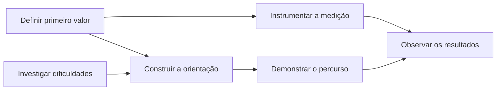

# Exemplo: orientar até o primeiro valor

**Cenário fictício para explicar a visão do produto.** As decisões, os repositórios e os resultados abaixo são ilustrativos. Este é um percurso narrativo, não um tutorial executável nem uma demonstração de funcionalidades integralmente disponíveis. O [README](../README.md#o-que-existe-hoje-e-o-que-está-em-construção) distingue a base existente da evolução em construção.

## A pergunta de negócio

Uma empresa percebe que novos clientes têm dificuldade para chegar ao primeiro uso útil de seu produto. O time considera criar uma orientação inicial, mas ainda precisa entender o problema e as alternativas.

O objetivo é **reduzir o tempo até o primeiro valor percebido**. Antes de definir uma meta numérica, as pessoas responsáveis precisam combinar o que conta como primeiro valor, qual população observar e de onde virão os dados. A situação inicial permanece desconhecida até existir medição válida.

## O contexto muda o que vale construir

O conjunto de repositórios oferece informações que ajudam a preparar a decisão:

| Fonte fictícia | O que informa | O que precisa ser conferido |
| --- | --- | --- |
| Contas | Plano e preferências da pessoa cliente | Se os dados podem ser usados nesse contexto e estão atualizados. |
| Ativação | Fluxo dos primeiros passos | Quais dificuldades foram observadas e quais capacidades já existem. |
| Comunicação | Mensagens e preferências de contato | Consentimento e adequação do canal. |
| Medição | Eventos e cálculo das métricas | Se é possível relacionar cadastro, exposição e primeiro valor. |

Uma fonte pode estar sem descrição publicada ou sem clone local. Ela deve continuar reconhecível como ausência ou limitação. Uma capacidade descrita como disponível ainda precisa de referências e comprovação adequadas ao uso pretendido.

Para registrar ou revisar essas informações, uma pessoa pode preencher os campos manualmente ou pedir ajuda ao Cup sobre as fontes selecionadas. A proposta permanece editável. Publicar a descrição exige o ato próprio de revisão e os poderes correspondentes; escolher uma pasta não concede esses poderes.

## Comparar antes de escolher

O time considera três caminhos: orientar os primeiros passos, oferecer apoio personalizado ou simplificar a configuração. As referências dos repositórios ajudam a examinar reutilização, dependências e dúvidas. A prioridade continua sendo uma decisão humana.

Neste exemplo, a pessoa responsável escolhe **orientar os primeiros passos**, apoiada por entrevistas e pela possibilidade de reutilizar partes do fluxo de ativação. A disponibilidade da medição é uma condição de avanço. A escolha registra também por que as outras alternativas não serão seguidas nessa rodada.

A direção é **permitir que novos clientes alcancem o primeiro valor com orientação clara**. Autorizar essa direção não libera automaticamente orçamento, acesso a dados ou todos os trabalhos que possam aparecer no plano.

## Transformar a escolha num plano

Cada entrega precisa de responsável, limites, dependências e critérios de aceite. Neste plano ilustrativo:

- **Produto e pesquisa** definem primeiro valor e investigam as dificuldades com referências consultáveis.
- **Experiência e engenharia** constroem a orientação, considerando as capacidades reutilizáveis e as condições de acesso.
- **Dados e engenharia** instrumentam eventos e conferem se a medição representa o que foi combinado.
- **As pessoas responsáveis pela revisão** examinam o percurso e suas evidências antes do avanço aplicável.

São responsabilidades do exemplo, sem exigir departamentos separados. Uma pessoa pode assumir várias delas quando seu contexto e seus poderes permitem.

## Recusas e retomada fazem parte do percurso

Se a fonte mudar depois da preparação de uma publicação, a base precisa ser reconferida. Se os poderes da pessoa forem revogados, o rascunho não autoriza a escrita. Se uma gravação for interrompida, a retomada precisa reconhecer a operação e conferir sua continuidade.

Guardar um rascunho preserva a preparação para continuar depois. A reabertura deve deixar visível o que ainda falta e o que precisa de nova conferência. O Cup pode ajudar a compreender a situação, mas não remove impedimentos nem substitui a pessoa autorizada.

## Conferir a entrega e observar o efeito

A demonstração do percurso pode comprovar que a orientação funciona para os critérios examinados. Ela não comprova que clientes reais perceberão valor mais cedo.

Para observar o efeito, o time define a fonte dos eventos, o período, a população, as exclusões e a regra de cálculo. Contas de teste e pessoas sem janela completa de observação precisam de tratamento explícito. Falta de dados não vira resultado zero.

O [conjunto de arquivos deste exemplo](primeiro-valor/README.md) ilustra essa medição com dados inteiramente sintéticos: média inicial de dez dias, acompanhamento de quatro e alvo de três. O resultado fica acima do alvo, e o veredito pede mais evidência. Esses números não representam clientes reais ou efeito comprovado da Guilda. Mesmo com um valor observado, a associação com a iniciativa não basta para atribuir causalidade.

## Voltar à decisão

Com as evidências da entrega e a observação do resultado, as pessoas responsáveis podem manter a direção, ajustá-la, investigar uma dúvida ou encerrar a aposta com justificativa. O registro permite recuperar o caminho: por que se escolheu, o que foi autorizado, o que foi entregue e o que realmente se aprendeu.

Esse retorno conecta estratégia, coordenação e execução. Para o desenho técnico que sustenta essas relações, leia [Como a Guilda é construída](../docs/arquitetura.md).

## Ler e conferir os registros

O [cenário completo](primeiro-valor/README.md) liga tese, objetivo, métrica, alvo, iniciativa, análise, ativação, direção, plano, trabalhos, evidências, resultado, veredito e QRD. Os [schemas públicos](../schemas/README.md) documentam os formatos reais, sem concentrar hipótese e medição artificialmente na Intent.
