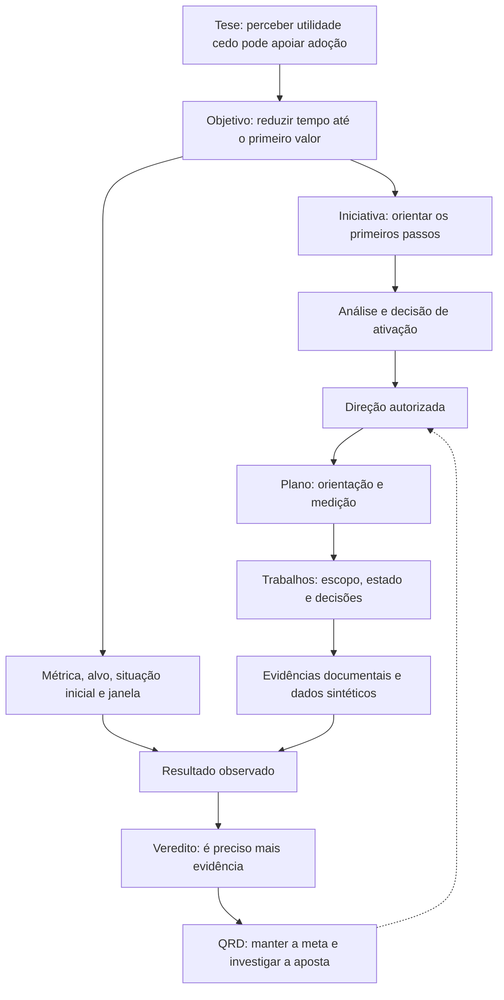

# Cenário completo: primeiro valor

**Todos os responsáveis, decisões, dados e resultados são fictícios.** Este conjunto demonstra leitura independente e relações entre registros; não é uma exportação de clientes nem prova de uma entrega real da Guilda. O [percurso narrativo](../primeiro-valor.md) explica a cena de produto.

## Da aposta à revisão do resultado



O objetivo é diminuir o tempo até o primeiro uso útil. A hipótese de que orientação ajuda fica no contexto da iniciativa e em sua investigação. A tese fornece o enquadramento mais amplo. A Intent conserva a direção autorizada e referencia métrica e alvo; o plano não guarda uma cópia do andamento dos trabalhos.

## Onde está cada informação

| Pergunta | Arquivo |
| --- | --- |
| Que enquadramento orienta a oportunidade? | [Tese](business/thesis.yml) |
| Qual efeito se procura? | [Objetivo](business/objective.yml) |
| Como calcular o resultado? | [Métrica](business/metric.yml) |
| Qual alvo, situação inicial e janela? | [Alvo](business/target.yml) |
| Qual problema, hipótese e dúvidas? | [Iniciativa](initiatives/primeiro-valor/initiative.yml) e [investigação](initiatives/primeiro-valor/references/investigacao.md) |
| O que a análise respondeu? | [Triagem](initiatives/primeiro-valor/triage.yml) |
| Qual direção foi autorizada no exercício? | [Decisão de ativação](initiatives/primeiro-valor/activation.yml) e [Intent](intents/orientar-primeiro-valor/intent.yml) |
| Quais fases, critérios e dependências? | [Breakdown](intents/orientar-primeiro-valor/breakdown.yml) |
| Qual escopo e andamento? | [Brief da orientação](works/orientacao-inicial/brief.yml), [estado](works/orientacao-inicial/state.yml), [brief da medição](works/medicao-primeiro-valor/brief.yml) e [estado](works/medicao-primeiro-valor/state.yml) |
| Quais decisões leves foram registradas? | [Despachos da orientação](works/orientacao-inicial/dispatches.yml) e [da medição](works/medicao-primeiro-valor/dispatches.yml) |
| Que material sustenta a conferência? | [Percurso documental](works/orientacao-inicial/evidence/percurso.md), [CSV](works/medicao-primeiro-valor/evidence/observations.csv) e [verificação](works/medicao-primeiro-valor/evidence/verification.yml) |
| Qual valor foi observado no exercício? | [Resultado](business/outcome.yml) |
| O que a pessoa conclui? | [Veredito](business/verdict.yml), [índice de QRDs](works/medicao-primeiro-valor/deliberation.yml) e [QRD](works/medicao-primeiro-valor/deliberations/qrd-rever-aposta.md) |

Os dois trabalhos permanecem `active/verifying`. Registrar o exemplo de um resultado não fecha trabalhos nem aprova operações reais. O cenário começa no cadastro direto de iniciativa; propostas preliminares são opcionais e não foram criadas apenas para preencher a árvore.

## Conferir a medição sem o aplicativo

O CSV contém três observações por grupo e durações em milissegundos. O procedimento está no registro da métrica. A diferença entre os instantes de cadastro e primeiro valor reproduz cada duração.

| Grupo sintético | Durações em dias | Média |
| --- | --- | --- |
| Situação inicial | 9, 10 e 11 | 10 dias — `864000000` ms |
| Acompanhamento | 3, 4 e 5 | 4 dias — `345600000` ms |
| Alvo ilustrativo | — | 3 dias — `259200000` ms |

A janela de acompanhamento vai de 1 a 15 de novembro de 2026. A situação inicial é anterior, com sua própria data. O resultado observado permanece acima do alvo de três dias. O veredito pede mais evidência, e a QRD ilustra a decisão de investigar sem atribuir efeito causal.

Esses números são uma construção didática; não demonstram ganho real de clientes, produtividade ou retorno financeiro. Falta de observação em outro cenário deve ser declarada, sem gerar um resultado artificial.

## Índice, revisões e validação

[catalog.json](catalog.json) associa cada registro ao schema, identidade, revisão e SHA-256 dos seus bytes. Também liga o identificador da evidência ao CSV. É um índice deste pacote de exemplo, não um novo contrato canônico nem uma definição de autoridade.

As referências revisionadas usam `acme-example` como namespace do exercício. Caminhos são relativos ao arquivo que os declara. Os comentários `yaml-language-server` apontam para os schemas locais sem adicionar campos ao registro. Os exemplos incluem o mínimo necessário para cada forma, mantendo as relações do cenário completo.

Na raiz do repositório:

```bash
npm ci
npm run check
```

O verificador confere os schemas, os 19 registros YAML, anexos, referências e cálculo. Os testes negativos mostram recusas de alterações indevidas, referências ausentes e medição incoerente. A instalação baixa apenas as dependências públicas; a conferência dos registros ocorre localmente.

Para os formatos e seus limites, leia [schemas/README.md](../../schemas/README.md). Textos e dados deste exemplo estão sob [CC BY 4.0](../../LICENSE); schemas e validador independente estão sob [MIT](../../schemas/LICENSE).
